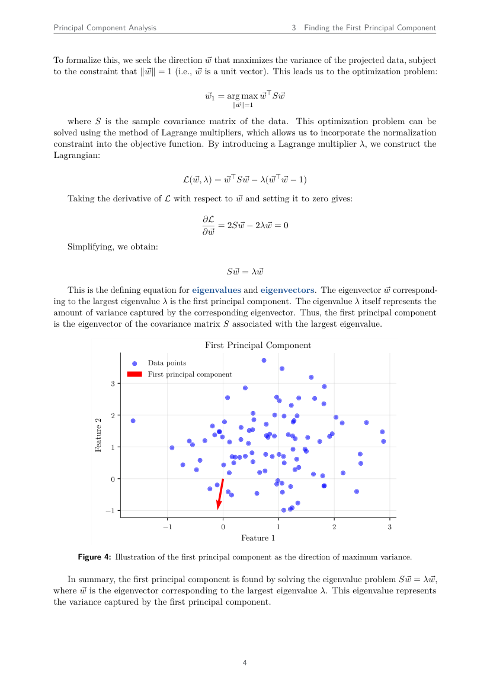
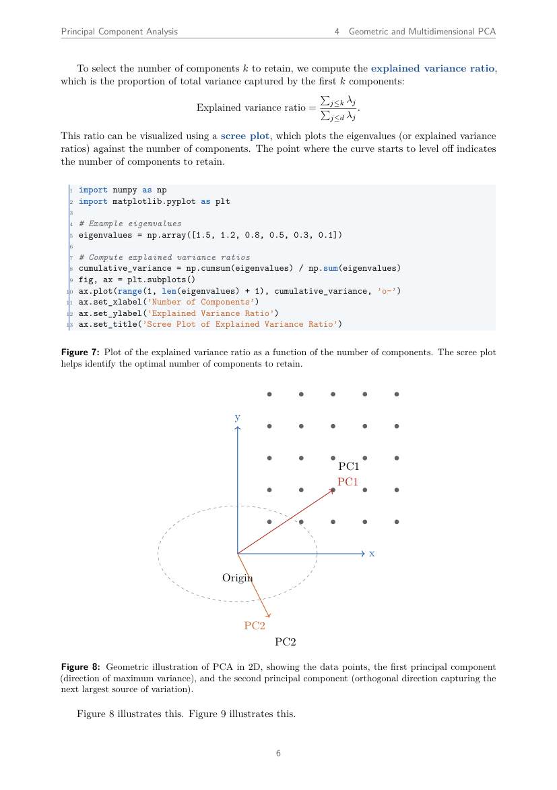
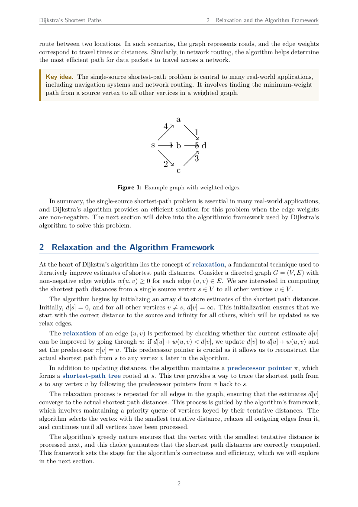
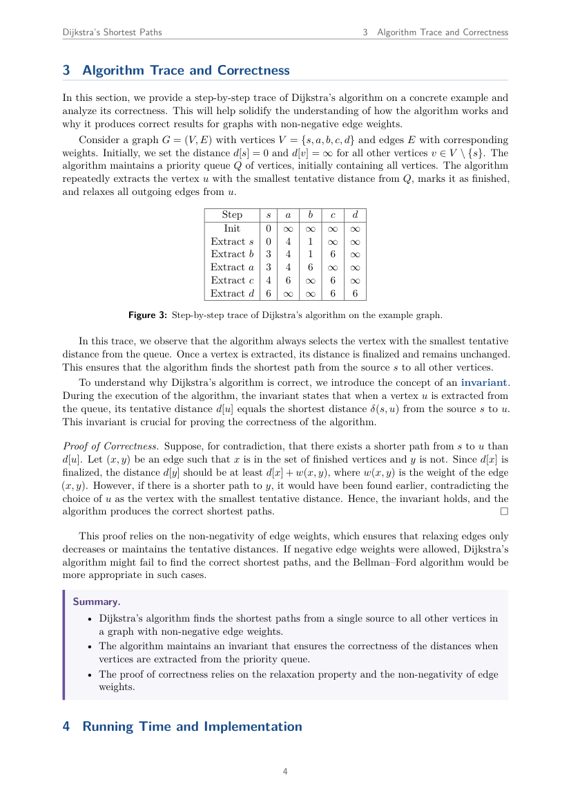
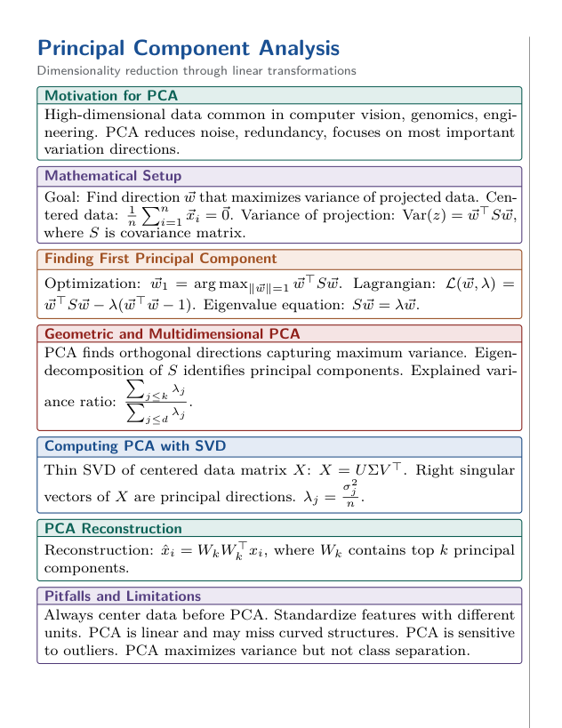
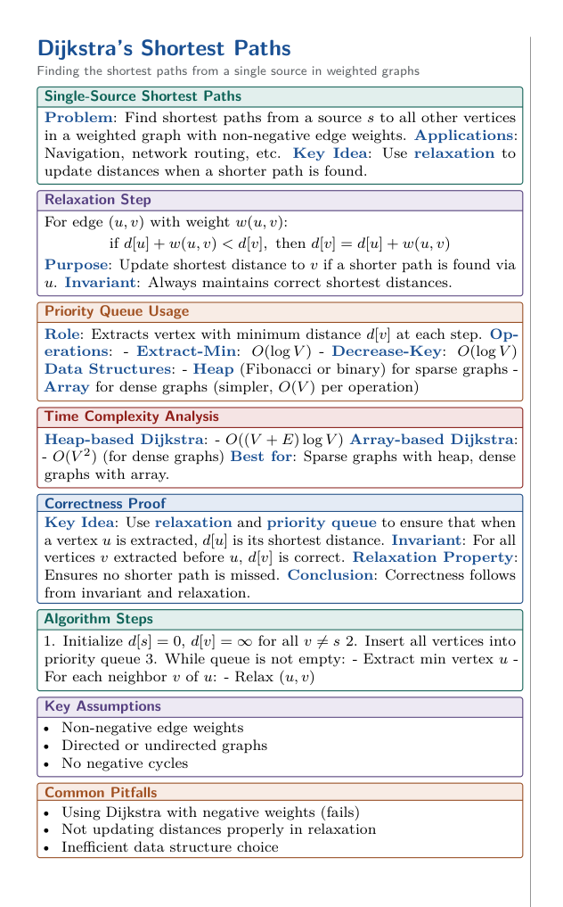

# LectureNotes: a 4B agent for LaTeX lecture notes

*Status as of 20 Nov 2026. Student model: **Qwen3-4B-Instruct-2507** + LoRA. Teacher model: **Qwen3-14B**. Hardware: V100-32GB. Pipeline: SFT → GRPO; the final model is the GRPO round-20 checkpoint.*

**Input:** a topic, plus optional slides, a slide range and a target length. **Output:** `notes.pdf` with its LaTeX source and code-generated figures, a cheat sheet, and a run report.

## How the harness works

A model under 4B cannot write a 10-page LaTeX document in one pass. So the model only does short, checkable steps, and a deterministic harness checks every step:

```
plan (JSON) → section drafts (best-of-n) → verifier ⇄ SEARCH/REPLACE repairs
            → revise for coverage/length → assemble + compile → cheat sheet
```

- **best-of-n:** the model writes several drafts of a section, and the harness keeps the one with the highest score.
- **SEARCH/REPLACE repair:** on an error, the model gets the compiler message and replies with a small edit ("replace this snippet with that one"). It does not rewrite the whole section.

The verifier checks:
- **Lint and autofix:** forbidden commands, unbalanced braces and environments, Markdown leaks.
- **Isolated compile:** each section is compiled on its own with the real preamble.
- **Figures:** matplotlib runs in a sandbox and TikZ is compiled standalone. Each output is checked for blank output, overlapping elements and overlapping labels.
- **Web images:** Wikimedia Commons only, free licenses only.
- **Content:** length against the budget, coverage of the plan's key points, repetition and filler phrases.

A section that still fails after repairs is cut out instead of breaking the whole document.

The same harness serves as the inference verifier, the training-data filter, the RL reward and the benchmark.

**Reward** = (0.25·figures + 0.2·length + 0.25·coverage + 0.3·structure) × substance − penalties

- *Structure* means correct boxes (definition, key idea), no Markdown leaks and no broken environments.
- *Substance* scales the score by how much real prose the section has.
- *Penalties* are charged for autofixes, overfull boxes, repetition and filler phrases.

## Training

| Data | Amount |
|---|---|
| arXiv lecture notes/tutorials (permissive licenses) | 6,799 compile-verified sections |
| DaTikZ (caption → TikZ) | 10,503 tasks |
| Teacher trajectories: Qwen3-14B ran the full agent on 400 topics (35% with slides); only steps that passed the harness were kept | 5,725 rows |
| Synthetic repairs (injected errors) | 15k LaTeX + 6k figure |

1. **SFT stage 1:** 43.5k examples covering all task types: repair, figure, section, plan, image pick, cheat sheet. Settings: LoRA r64/α128 on all projections, lr 2e-4, 2 epochs, max length 8k, fp16. Validation loss went from 0.476 to 0.429.
2. **SFT stage 2:** 5.5k examples in the target notes style, lr 5e-5. Validation loss on the full mixed set ended at 0.447.
3. **GRPO:** reinforcement learning with the harness score as reward, a fresh LoRA on the merged SFT model (groups of 8 rollouts, 64 prompts per round, KL β 0.02 against the SFT policy). Rollouts run on vLLM; since vLLM's LoRA kernels do not build on V100, the adapter is merged and vLLM restarted every round. The section-writing reward peaked around rounds 10–20 and then degraded (more compile failures, more repetition), so the **round-20 checkpoint is the final model**; the 60-round model was worse on the benchmark.

**V100 issue:** Qwen3 uses grouped-query attention, which V100's fused attention kernel cannot run. PyTorch fell back to plain attention and ran out of memory at step 0. Expanding K/V before the attention call fixed it: peak memory at 8k tokens is now 16.5 GB.

## Benchmark (30 held-out topics, same harness)

The 30 topics appear in no training data. "Units cut out" counts sections or figures that still failed after all repairs and were removed from the notes.

| Metric | Base Qwen3-4B | SFT | GRPO (round 20) |
|---|---|---|---|
| Notes compiled | 30/30 | 30/30 | 30/30 |
| First drafts that compile | 80% | **100%** | **100%** |
| Figures rendered and lint-clean | 44% | 82% | **87%** |
| Length error | 16% | 9% | **7%** |
| Key-point coverage | 94.0% | 94.6% | **95.6%** |
| Mean section reward | 0.74 | 0.80 | **0.82** |
| Repair calls per section | 1.77 | **0.89** | 0.92 |
| Units cut out after failed repairs (per lecture) | 0.9 | **0** | **0** |
| Time per lecture on one V100 | ~3.7 min | ~4 min | ~3–4 min |

**Figure relevance (VLM judge, Qwen2.5-VL-7B, score 1–5 for "does the figure show what its caption says"):**

| | Base | SFT | GRPO (round 20) |
|---|---|---|---|
| Figures per lecture | ≈3 | ≈8 | ≈8 |
| Relevant (score ≥4) | ≈98% | 88% | **89%** |
| Irrelevant (score ≤2) | 0% | 6% | 6% |

SFT gives about 2.5× more relevant figures per lecture; GRPO keeps the count and slightly improves relevance. The cost is a few off-topic ones: 13 of the 15 are web images (portraits, "further reading" images, an unrelated tank). The base model rarely gets a figure through the harness at all. The judge catches the off-topic images but not overlapping labels, which the TikZ overlap check handles.

## Examples from slides

The input decks are 8–9 Beamer slides each, written for this report (`examples/slides/*.tex`). The full outputs (SFT model) are in `examples/out/pca/` and `examples/out/dijkstra/`; `examples/out/l9_full/` and `examples/out/l9_perceptron/` are from the final GRPO model on a real course deck. None were edited.

**PCA, slides 2–9, target 5 pages:** 9 pages, 10/10 figures, 282 s.

| | |
|---|---|
|  |  |
| ✅ Lagrangian derivation is correct. ❌ The PC1 arrow points across the point cloud instead of along it. | ❌ The code listing is typeset as a figure, and the PC1/PC2 labels are duplicated. |

**Dijkstra, all slides:** 6 pages, 3/3 figures, 243 s.

| | |
|---|---|
|  |  |
| ❌ The graph was redrawn with wrong edges; reusing the slide image would have been correct. | ❌ The trace table is copied wrong, even though the slide has it right. |

The cheat sheets for both topics are correct and compact:  

## Strengths and weaknesses

**Strengths**
- Always produces a compiled document.
- Word count stays within 5–10% of the budget, and about 95% of the planned key points are covered.
- Follows the slide order and expands short bullets into explanations.
- Math is mostly correct.
- Data plots are good.
- Typography is consistent.
- Runs in about 4 minutes on one V100.

**Weaknesses**
- **Figures are the weakest part.** Some are wrong: the PCA arrow, the Dijkstra graph. Some web images are off-topic: 6% of figures by the judge's score. Some TikZ diagrams have overlapping labels. The reward checks that a figure renders, not that it is correct, which is a risk for RL. The VLM judge is meant to close this gap.
- **Errors when copying from slides.** Slide images are rarely reused.
- **Filler prose,** such as "In summary, X is a powerful tool…".

